# SupportPilot – AI Ticket Resolution Agent

**Milestone 1: Ticket Ingestion, AI Classification, Severity Prediction & Priority Assignment**

SupportPilot is a web-based IT support ticket management prototype. It accepts employee support requests, predicts the ticket category using a machine-learning text classifier, estimates severity and business impact using rule-based logic, and assigns a priority level. Submitted tickets are stored in an SQLite database and displayed on a dashboard.

> **Milestone 1 status:** Core workflow implemented and tested. The evaluation results below are reported as measured; the classification target has not yet been reached.

## Features implemented

- **Ticket submission:** Employees can submit their name, email address, ticket title and issue description through the dashboard.
- **Automatic category classification:** A TF-IDF and Logistic Regression pipeline predicts one of six categories: Network, VPN, Password, Software, Hardware or System.
- **Severity prediction:** Rule-based logic assigns Critical, High, Medium or Low severity based on issue wording.
- **Business impact assessment:** Rule-based checks estimate High or Low business impact.
- **Priority assignment:** A rule-based mapping assigns P1, P2, P3 or P4.
- **Database storage:** Ticket details and analysis results are saved in SQLite.
- **Dashboard:** Displays ticket statistics, AI analysis results and recently submitted tickets.
- **REST API:** Flask endpoints support ticket submission and ticket retrieval.

## Technology stack

| Area | Technology |
|---|---|
| Programming language | Python |
| Backend | Flask |
| Machine learning | scikit-learn |
| Text representation | TF-IDF |
| Classification algorithm | Logistic Regression |
| Data handling | pandas |
| Model persistence | joblib |
| Database | SQLite |
| Frontend | HTML, CSS, Bootstrap, JavaScript |
| API format | JSON / Flask REST endpoints |

## System workflow

1. An employee submits a support ticket through the web dashboard.
2. The backend combines the ticket title and description for analysis.
3. The trained TF-IDF and Logistic Regression pipeline predicts the ticket category.
4. Rule-based logic estimates severity and business impact.
5. The priority mapping assigns a priority level.
6. The ticket and its analysis results are stored in SQLite.
7. The dashboard displays the analysis result and refreshes the recent-ticket list.

## Priority mapping

| Severity | Business impact | Assigned priority |
|---|---|---|
| Critical | High or Low | P1 |
| High | High | P1 |
| High | Low | P2 |
| Medium | High or Low | P3 |
| Low | High or Low | P4 |

## Project structure

```text
support_pilot/
├── app.py
├── classifier.py
├── database.py
├── train_model.py
├── evaluation.py
├── evaluate_severity.py
├── test_classifier.py
├── test_database.py
├── test_priority.py
├── requirements.txt
├── data/
│   ├── tickets.csv
│   └── severity_test.csv
├── models/
│   └── ticket_classifier.pkl
├── templates/
│   └── index.html
├── static/
│   └── style.css
└── tickets.db
```

The SQLite database and trained model are generated locally when the project is run. The `venv/` virtual environment should not be committed to Git.

## Evaluation and testing

The following are the results observed during Milestone 1 testing:

| Component | Evaluation result | Target / interpretation |
|---|---:|---|
| Category classification | **72.92%** | 90% target not achieved yet |
| Severity prediction | **100% (20 test cases)** | Exceeds the 85% target on the manually prepared test set |
| Priority mapping | **100% (6 rule cases)** | All six predefined rule combinations passed |
| Ticket submission and retrieval | Passed in functional testing | Flask and SQLite integration verified |

### Evaluation notes

- Category classification was evaluated using cross-validation on the current dataset of 48 ticket examples. The measured result was **72.92%**, so the 90% classification target remains future work.
- Severity evaluation used 20 manually labelled test examples, with five examples for each severity class. All 20 matched the expected labels. This is a small, manually prepared test set and should not be interpreted as proof of performance on real-world tickets.
- Priority evaluation checked six predefined severity/business-impact combinations. All six produced the expected priority. This measures rule coverage, **not** machine-learning prediction accuracy.
- The dataset is a small prototype dataset. More varied, independently labelled support tickets are needed for a stronger evaluation and to improve classification performance.

## Screenshots

The screenshots below document the implementation and Milestone 1 tests.

### 1. Model training and classification report
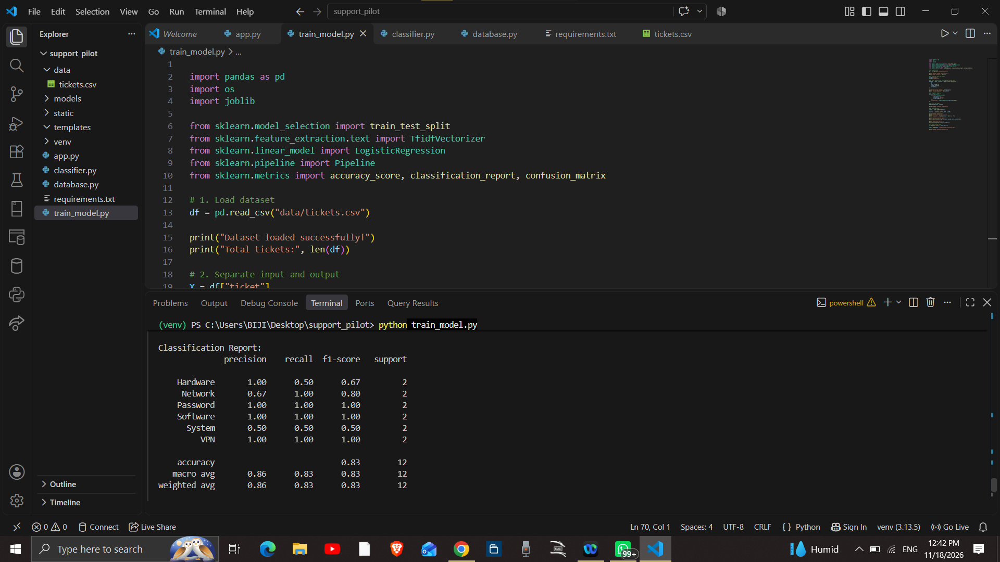

### 2. Category prediction examples
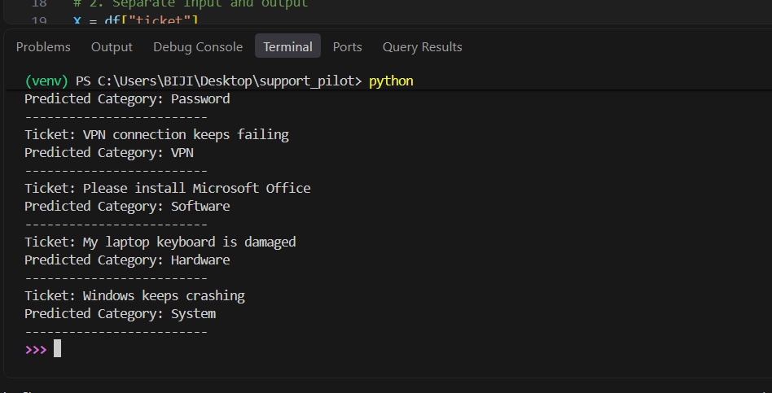

### 3. Severity, business impact and priority predictions
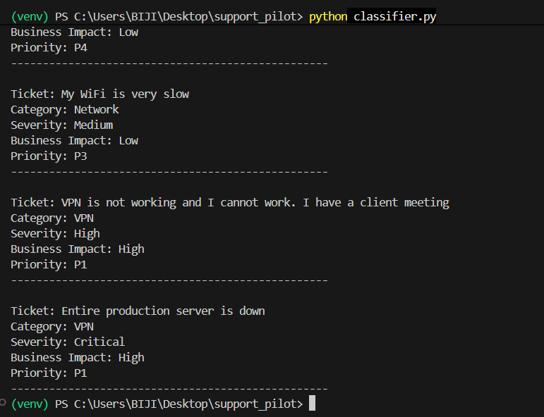

### 4. SQLite database creation and retrieval test
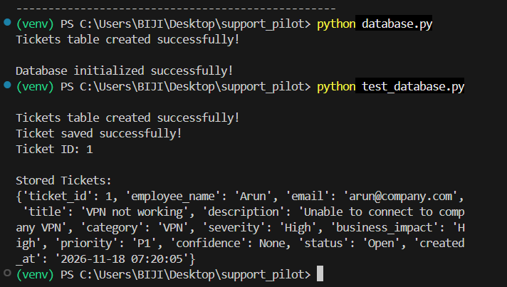

### 5. Flask API running
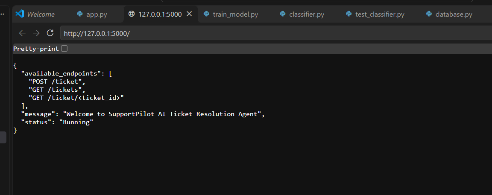

### 6. SupportPilot dashboard
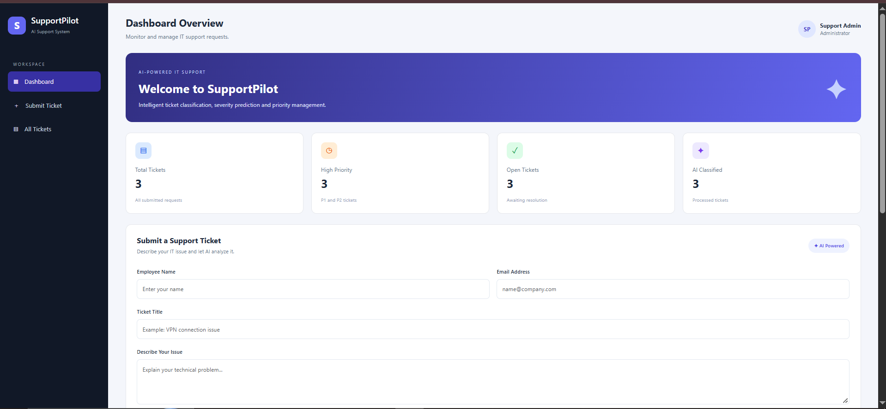

### 7. Ticket submission and AI analysis result
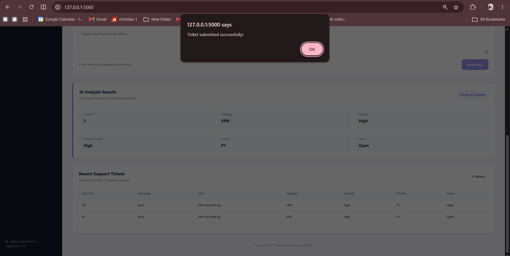

### 8. Recent tickets displayed on the dashboard
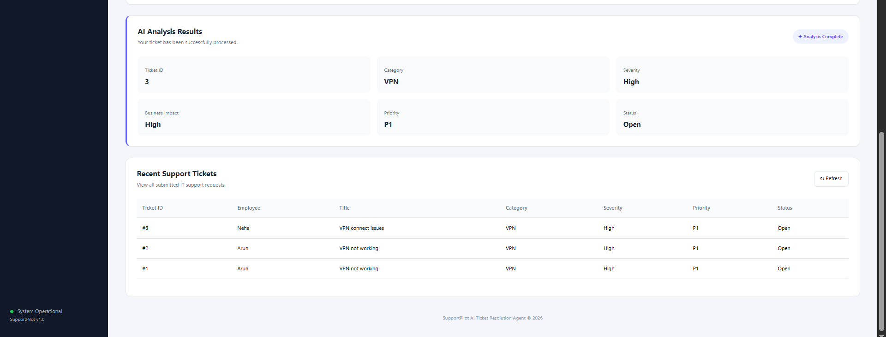

### 9. Classification cross-validation results
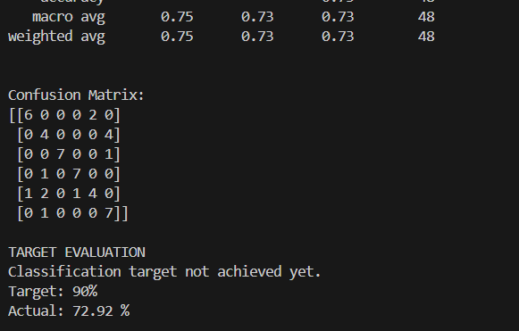

### 10. Severity evaluation results
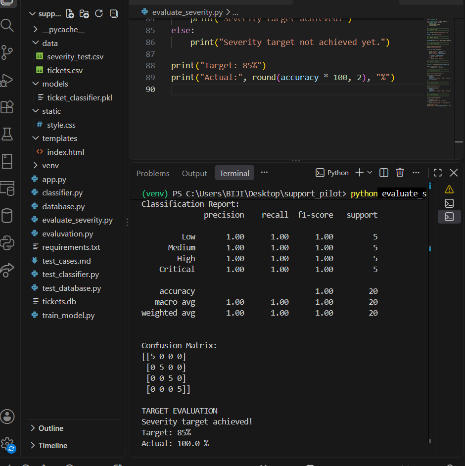

### 11. Priority rule evaluation results
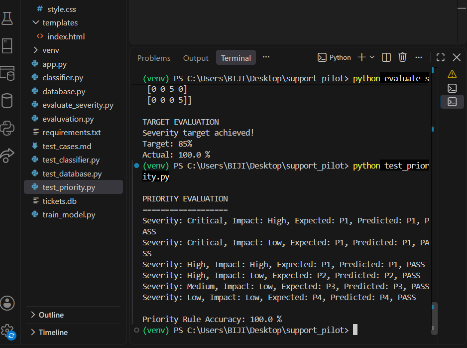

## Setup and run locally

### 1. Clone the repository

```bash
git clone <your-repository-url>
cd support_pilot
```

### 2. Create and activate a virtual environment

**Windows PowerShell:**

```powershell
python -m venv venv
.\venv\Scripts\Activate.ps1
```

### 3. Install dependencies

```bash
pip install -r requirements.txt
```

### 4. Train the classification model

```bash
python train_model.py
```

This creates the trained model at `models/ticket_classifier.pkl`.

### 5. Start the Flask application

```bash
python app.py
```

Open **http://127.0.0.1:5000/** in your browser.

## API endpoints

| Method | Endpoint | Purpose |
|---|---|---|
| `GET` | `/` | Loads the SupportPilot dashboard |
| `POST` | `/ticket` | Submits, analyses and stores a ticket |
| `GET` | `/tickets` | Retrieves all stored tickets |
| `GET` | `/ticket/<ticket_id>` | Retrieves a ticket by its ID |

### Example ticket request

```json
{
  "employee_name": "Alex",
  "email": "alex@company.com",
  "title": "VPN connection issue",
  "description": "Unable to connect to the company VPN."
}
```

## Current limitations and future improvements

- Increase the size and diversity of the labelled ticket dataset.
- Improve category classification to meet the 90% target using better training data and further model tuning.
- Validate severity rules against a larger, independently labelled real-world dataset.
- Add confidence-score calibration and display prediction confidence in the dashboard.
- Add ticket status updates, filtering and search.
- Explore a larger evaluation set and monitor performance across categories.

## Milestone 1 outcome

Milestone 1 delivers a working end-to-end prototype for ticket submission, automated category prediction, severity and business-impact assessment, priority assignment, database storage and dashboard display. Severity and priority rule tests passed on the prepared test cases. Category classification currently measures **72.92%**, and improving it to the 90% target is an identified next step.

---

